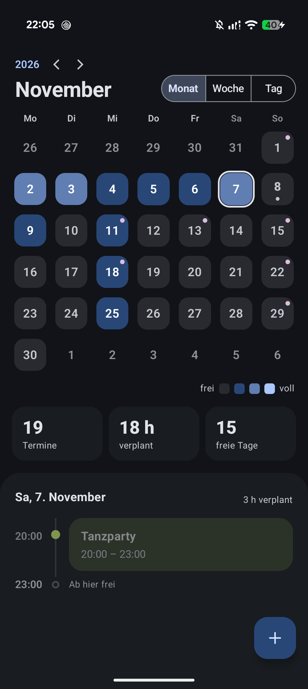
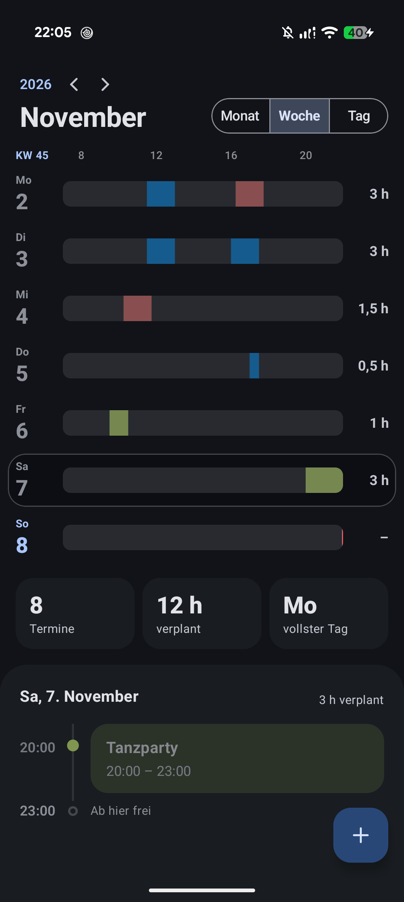
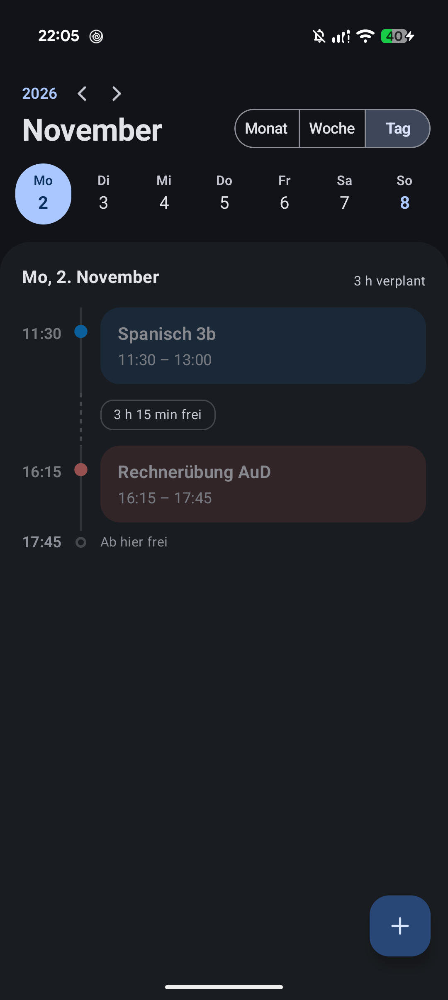
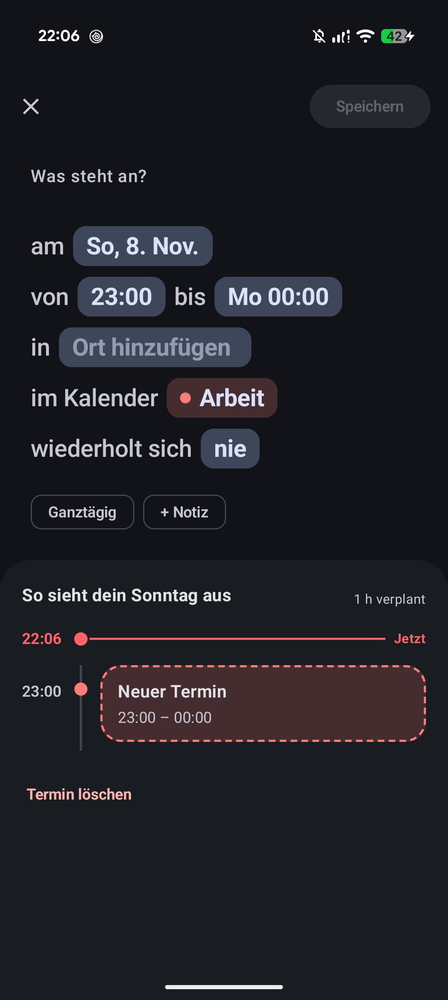
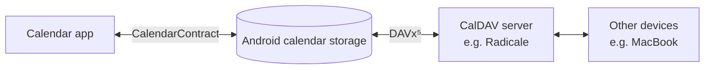

# Calendar

A clean, privacy-friendly calendar app for Android, built with Kotlin and Jetpack Compose.

It works directly on top of Android's own calendar storage, so there is no account and no extra cloud. Your events stay on your device, and you sync them with any CalDAV server (for example a self-hosted [Radicale](https://radicale.org)) using [DAVx⁵](https://www.davx5.com).


<!-- Screenshots: put the images in docs/screenshots/ and they show up here -->
| Month | Week | Day | Editor |
|:---:|:---:|:---:|:---:|
|  |  |  |  |

## Features

**Three views that show how busy you are, not just what's planned**
- **Month:** every day is shaded by how much time is booked, with monthly stats below
- **Week:** one bar per day from 7 to 22 h, so free slots stand out at a glance
- **Day:** a timeline with your events, the free time in between and a live "now" line
- Swipe left and right to move between months, weeks or days

**Fast to add, easy to edit**
- Quick-add sheet: title, day, time and duration in a few taps
- Full editor that reads like a sentence: *"Study group on Wed, 14 Oct from 16:00 to 18:00 in Library"*
- A preview of the whole day while you edit, so you see clashes right away

**Recurring events**
- Daily, weekly, monthly or yearly, with an optional end date
- Edit or delete just one occurrence or the whole series

**Works with your existing calendars**
- Shows every calendar on the device, in its own colour
- Read-only calendars (like holidays) are shown but can't be edited
- Light and dark theme

## How it works

The app doesn't store or sync anything itself. It reads and writes Android's calendar database through [`CalendarContract`](https://developer.android.com/reference/android/provider/CalendarContract), and a sync app takes care of the server.



Because of this, it also works with any other calendar account Android already syncs, such as Google Calendar.

## Getting started

### Requirements

- Android 12 (API 31) or newer
- Android Studio (latest stable version) to build the app
- Optional, for syncing: [DAVx⁵](https://www.davx5.com) and a CalDAV server

### Build and run

1. Clone the repository:
   ```bash
   git clone <repository-url>
   ```
2. Open the project in Android Studio and let Gradle sync.
3. Connect a device (or start an emulator) and press **Run ▶**.
4. Allow calendar access when the app asks for it.

### Sync with your own server (optional)

1. Install DAVx⁵ on your phone.
2. Add an account with your CalDAV server address and login.
3. In DAVx⁵, select the calendars you want to sync.
4. Open the calendar app: the synced calendars appear automatically.

## Project structure

```
app/src/main/java/de/burkha/calendar/
├── data/                   Reading and writing events
│   ├── CalendarRepository  All access to CalendarContract
│   ├── CalendarEvent       An event as the views show it
│   ├── EventDraft          An event while it is being edited
│   └── TimeConversions     Converting between millis and local date/time
└── ui/
    ├── CalendarViewModel   State of the app, connects UI and repository
    ├── components/         Shared building blocks (header, timeline, dialogs)
    ├── month/ week/ day/   The three views
    ├── editor/             Quick-add sheet and full editor
    └── theme/              Colours, typography, shapes
```

## Tech stack

- **Language:** Kotlin
- **UI:** Jetpack Compose, Material 3
- **Architecture:** ViewModel + repository, coroutines for database access
- **Data:** Android Calendar Provider (`CalendarContract`)
- **Sync:** none built in; uses DAVx⁵ or any other sync adapter

## Roadmap

- [x] Month, week and day views
- [x] Create, edit and delete events
- [x] Recurring events with end date, single-occurrence edits
- [ ] Settings: start view, theme, visible calendars, default calendar and duration
- [ ] Event detail view (open an event without editing it)
- [ ] Reminders and notifications
- [ ] Home screen widget
- [ ] First-start introduction
- [ ] Refresh automatically when the app comes back to the foreground

## Known limitations

- The repeat rule of an existing series (e.g. weekly → monthly) can't be changed yet.
- An occurrence that was already edited on its own can only be changed on its own. To change the whole series, open a regular occurrence.
- The calendar of a recurring event can't be changed.

## About

A personal project by Johannes Burkhardt. The UI was designed with [Claude](https://claude.ai); the app logic is written by me.

## License

Released under the [MIT License](LICENSE).
